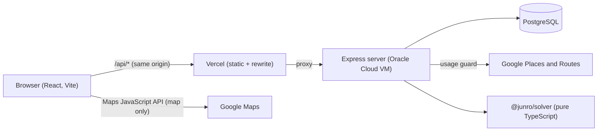

# Junro 順路

Junro is a trip planner. You lay out a trip day by day, drop places onto each day, and Junro
finds the fastest order to visit them — respecting how long you like to stay and when each place
is open.

## The name

順路 (_junro_) means "the route to follow". It is the arrow sign you see in Japanese museums that
tells you which way to walk next.

## Live demo

**https://junro.vercel.app** (sign in with Google).

## What it does

- **Trips and days.** A trip has an origin and a destination airport; each day has a start, an
  end, a start time and a travel mode (walking or driving).
- **Places.** Search with Google Places, pick a category (restaurant, temple, museum, transit
  stop and so on). Each category has a minimum stay that you can raise but never lower.
- **The fastest order.** "Find my route" picks the best order, shows the day as a timeline in
  plain words ("Back at the hotel by 19:40"), and draws the route on the map. Stops that cannot
  fit their opening hours are flagged, never dropped silently.
- **Editing a day.** Add a stop to a day that already has a route and choose: _keep my order_
  (the new stop goes where it adds the least time) or _recalculate everything_.
- **A day in progress.** Mark stops as done, then _recalculate from here_: Junro plans the rest
  of the day from where you are, at the current time, back to the same end point.

## How it works



- **One origin.** The browser only ever talks to the Vercel domain. Vercel forwards `/api/*` to
  the server, so the sign-in cookie is a plain first-party cookie (`Secure`, `HttpOnly`,
  `SameSite=Lax`). The Google API key never leaves the server.
- **The solver is pure.** `packages/solver` has no network, no database and no clock. It gets a
  `travelTime(from, to, departureTime)` function and returns an order, arrival times and
  violations. That is what makes it easy to test exhaustively (it is checked against brute force).
- **Google is behind a guard.** Place details are fetched once and stored; travel times are cached
  per day and only new pairs are requested; route lines are remembered per route. Every call is
  counted against monthly caps and per-user rate limits. See "Protecting the free tier" below.

### The route-ordering algorithm

Finding the best order of stops is the travelling salesman problem with time windows, which has
no known fast exact solution, but a day has few stops (at most 15), so Junro solves it exactly:

- **Held-Karp dynamic programming** over subsets. A state is "which stops are visited, and which
  was last". For each state the solver keeps the best ways to have got there, and extends them
  one stop at a time. Time `O(2^n * n^2)`, memory `O(2^n * n)` (times the number of labels
  below). For 15 stops that is about seven million steps per label, and a test keeps
  the worst case under a second.
- **Opening hours.** Arriving before a place opens means waiting; leaving after it closes means
  lateness. The best order has the least total lateness first (zero when everything fits), then
  the earliest return.
- **Pareto labels.** When something has to be late, "less late but leaving later" and "more late
  but leaving earlier" can each win in the end, so one number per state is not enough. The solver
  keeps every label that no other label beats on both counts. Waiting is allowed, so leaving
  earlier is never worse, and that makes the result exact.
- **Two edit modes.** _Minimal change_ keeps your order and inserts a new stop where it adds the
  least time (`insertStage`, `removeStage`). _Full recalculation_ runs the DP again.
- **Beyond 15 stops** the solver refuses instead of freezing the machine.

## Status

Beta, deployed. Done: repository setup (M0), the solver (M1), the server core (M2), the Google
integration (M3), the client (M4), a day in progress (M5) and the deployment (M6). Public transit
is next, after the beta.

## Tech stack

- **Client:** React + TypeScript + Vite (hosted on Vercel)
- **Server:** Node + Express + TypeScript, PostgreSQL (hosted on Oracle Cloud free tier)
- **Solver:** a pure TypeScript package — exact Held-Karp DP with time windows, no I/O
- **Maps and places:** Google Maps Platform

## Repository layout

| Path               | What it is                                     |
| ------------------ | ---------------------------------------------- |
| `client/`          | The web app                                    |
| `server/`          | The API server                                 |
| `packages/solver/` | The route-ordering algorithm (pure TypeScript) |
| `docs/`            | Design spec and milestone plans                |

## Running it

You need Node 22 (see `.nvmrc`).

```bash
npm install
npm run lint
npm test
```

## Running the server locally

You need Node 22 and Docker.

```bash
cp .env.example .env              # then edit SESSION_SECRET
docker compose up -d --wait       # PostgreSQL on port 5434 (databases: junro and junro_test)
npm run db:migrate -w @junro/server
npm run dev -w @junro/server      # http://localhost:3000/health
```

`npm test` also needs the database from `docker compose`.

### Google sign-in (optional locally)

1. In Google Cloud Console create an OAuth client ID of type "Web application".
2. Add `http://localhost:3000/auth/google/callback` as an authorised redirect URI.
3. Put the client ID and secret in `.env` (`GOOGLE_CLIENT_ID`, `GOOGLE_CLIENT_SECRET`,
   `GOOGLE_CALLBACK_URL`). Without them the server runs, and `/auth/google` answers 503.

## Google Maps Platform (places and routes)

The server uses the Places API (New) for search and place details, and the Routes API for
travel times and the route line. The API key lives only on the server (`GOOGLE_API_KEY`).

**Protecting the free tier.** Google gives a free monthly allowance per product (check the
current numbers on the
[pricing list](https://developers.google.com/maps/billing-and-pricing/pricing): at the time of
writing 10,000 / 5,000 / 1,000 calls for Essentials / Pro / Enterprise products). Place Details
with opening hours is an Enterprise product, so only 1,000 per month are free. Junro protects
itself in layers:

1. Every Google call goes through a usage guard that counts per API and per month (Pacific
   time, like Google's billing) and refuses before the cap. Defaults sit well below the free
   tiers; change them with `GOOGLE_CAP_AUTOCOMPLETE`, `GOOGLE_CAP_PLACE_DETAILS`,
   `GOOGLE_CAP_ROUTE_MATRIX` (counted in matrix elements) and `GOOGLE_CAP_COMPUTE_ROUTES`.
   A cap of `0` switches that API off.
2. A place is fetched from Google once and stored; search results are cached for 10 minutes;
   travel times are cached per day and only new points are requested; an unchanged route
   line is never requested again; every call asks only for the fields it needs.
3. Per-user rate limits on search, new places and solving.
4. Hard quotas in Google Cloud (below), as the last line of defence if the code has a bug.

### One-time setup in Google Cloud (manual)

Create a separate Google Cloud project for Maps (for example `junro-maps`): billing and quotas
are counted per project, so keep them apart from the project that holds the sign-in client
(the sign-in client does not need to move). Menu names change from time to time.

1. **Enable the APIs:** APIs & Services, Library. Enable **Places API (New)** and
   **Routes API**.
2. **Billing:** Google requires a billing account for Maps Platform even for the free tier.
   Billing, Budgets & alerts, create a budget of a few dollars with alerts at 50%, 90% and
   100%. A budget only warns; it does not stop spending. The quotas in step 4 do.
3. **API key:** APIs & Services, Credentials, Create credentials, API key. Under "API
   restrictions" choose "Restrict key" and select only Places API (New) and Routes API. Put
   the key in `.env` as `GOOGLE_API_KEY`. Never commit it, never send it to the browser.
4. **Hard quotas:** Google Maps Platform, Quotas (select the API at the top). Edit these
   "per day" quotas, which start as Unlimited. Sensible values for development:

   | API              | Quota                                                         | Daily limit |
   | ---------------- | ------------------------------------------------------------- | ----------- |
   | Routes API       | DistanceMatrix - ComputeRouteMatrix per-element quota per day | 500         |
   | Routes API       | Directions - ComputeRoutes per request quota per day          | 100         |
   | Places API (New) | GetPlaceRequest per day (Place Details)                       | 30          |
   | Places API (New) | AutocompletePlacesRequest per day                             | 300         |

   Optionally lower the "per minute" quotas too (they start at 3,000). These daily limits sit
   above normal use and far below the free allowance, so a bug cannot burn the month in a day.

5. Check the usage page of each API a few days after you start using Junro.

## Running the client locally

```bash
npm run dev -w @junro/client        # http://localhost:5173 (needs the server running too)
```

The client talks to the server through `/api` (Vite forwards it to `http://localhost:3000`, so the
browser sees one origin and the sign-in cookie just works). The map needs a browser key for the
Maps JavaScript API, restricted to `http://localhost:5173/*` and to that one API:

1. In Google Cloud, enable **Maps JavaScript API** and create a separate browser key.
2. Put it in `client/.env.local` as `VITE_GOOGLE_MAPS_BROWSER_KEY=...` (see `client/.env.example`).
3. Set a daily cap on map loads in the Maps Platform quotas page.

`/dev/map` (development only) shows the map and its markers with sample points.

## Looking at the database

Two ways to browse the tables, with the local database from `docker compose` running:

- **Drizzle Studio** (made for this project's schema): `npm run db:studio -w @junro/server`, then
  open https://local.drizzle.studio. Browse, filter and edit rows, and follow the links between
  tables.
- **Adminer** (a plain web page): `docker compose --profile tools up -d adminer`, then open
  http://localhost:8081. Choose "PostgreSQL", server `postgres`, user `junro`, password `junro`,
  database `junro` (or `junro_test` for the test database).

From a desktop tool (DBeaver, pgAdmin, the VS Code PostgreSQL extension) connect to
`localhost`, port `5434`, user `junro`, password `junro`.

## Airports

The `airports` table holds about 300 of the world's biggest and busiest airports, at least one
for every country that has a passenger airport (236 countries). It is reference data, loaded
from `server/data/airports.json`:

```bash
npm run db:seed:airports -w @junro/server   # safe to run again
npm run airports:build -w @junro/server     # rebuild the list from the sources (needs internet)
```

How the list is chosen: every country gets its best airport, then the remaining places go to
the best airports anywhere. "Best" means size class first (large, then medium, then small), then
the number of flight routes that touch the airport. Countries with no passenger airport at all
(Monaco, Vatican City, Liechtenstein, San Marino, Andorra and a few uninhabited territories) are
not in the list. A country whose airports have no scheduled flights at the moment, for example
because of war, still gets its biggest coded airport.

Sources and credits:

- [OurAirports](https://ourairports.com/data/), public domain: airports and countries.
- [OpenFlights](https://openflights.org/data), Open Database License: the routes file, used only
  to count routes per airport. It dates from 2014, so airports opened since then look quieter than
  they are, and the order inside the list is approximate.

## Deployment

- **Client:** Vercel, project root `client/`. `client/vercel.json` builds from the repository root
  (npm workspaces), forwards `/api/*` to the server and falls back to `index.html` for client
  routes. Set `VITE_GOOGLE_MAPS_BROWSER_KEY` in the project settings (a browser key is public by
  nature; it is protected by its referrer and API restrictions in Google Cloud).
- **Server:** one Ubuntu VM (Oracle Cloud free tier) with Node 22 and PostgreSQL, running as a
  systemd service (`deploy/junro.service`). All settings, secrets included, live in
  `/etc/junro.env` on the VM and are never in the repository: `NODE_ENV=production`, `PORT`,
  `DATABASE_URL`, `SESSION_SECRET`, `CLIENT_URL`, the three `GOOGLE_*` sign-in variables and
  `GOOGLE_API_KEY`.
- **Sign-in:** in Google Cloud add `https://<your-domain>/api/auth/google/callback` as an
  authorised redirect URI and the domain as a JavaScript origin, and put the same callback URL
  in `GOOGLE_CALLBACK_URL`.
- **Updating the server:**

  ```bash
  cd ~/Junro && git pull && npm ci
  set -a && . /etc/junro.env && set +a
  npm run db:migrate -w @junro/server
  sudo systemctl restart junro
  ```

- Behind a proxy the server trusts one hop (`trust proxy`), so it can tell the browser used HTTPS
  and send the `Secure` cookie.

## License

No license. The code is public to read; all rights reserved.
